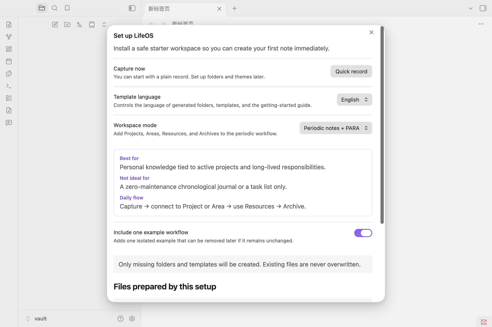
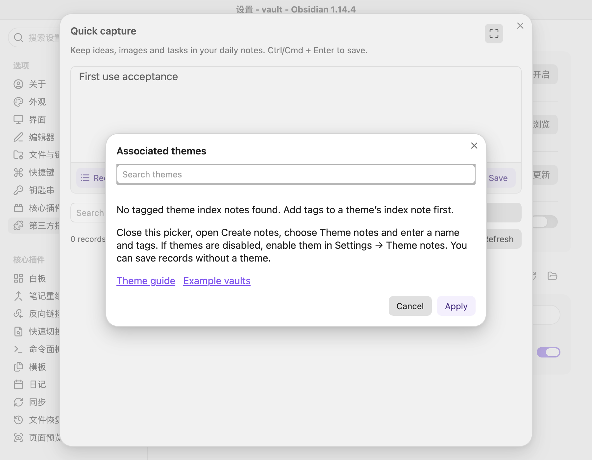

# Get started with open-source LifeOS

The first-use dialog offers Capture now. It creates only a missing basic daily template, preserves existing templates and notes, and adds no example content or workspace-mode profile. You can run workspace setup later to choose PARA, plain themes or periodic notes.

Open Quick capture, write your record, then select Save or press Ctrl/Cmd + Enter. Records are saved to today's daily note. Plain records do not require a theme, and capture and history work without Dataview.

To organize by topic, open Create notes → Theme notes and enter a name and tags. Enable theme notes in plugin settings if necessary. Add a `tags` property to each theme index so the picker can recognize it.

The picker links to the theme guide and example downloads. Closing it preserves your draft, so you can still save a plain record. Task, record and file aggregation queries require Dataview.

When Pro is also installed, use `LifeOSOpen` code blocks and helpers such as `LifeOSOpen.Theme.snapshot()` to select the open-source implementation explicitly. Existing notes are not rewritten.

- [Theme guide](theme-notes.en.md)
- [Example vaults](https://github.com/quanru/obsidian-example-lifeos/tree/main/examples)
