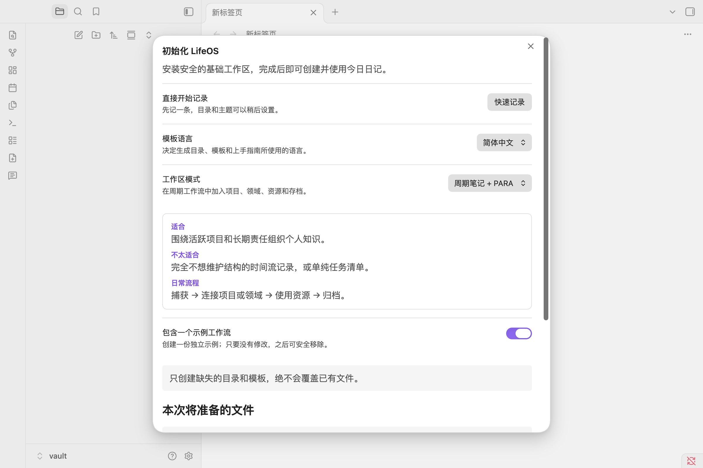
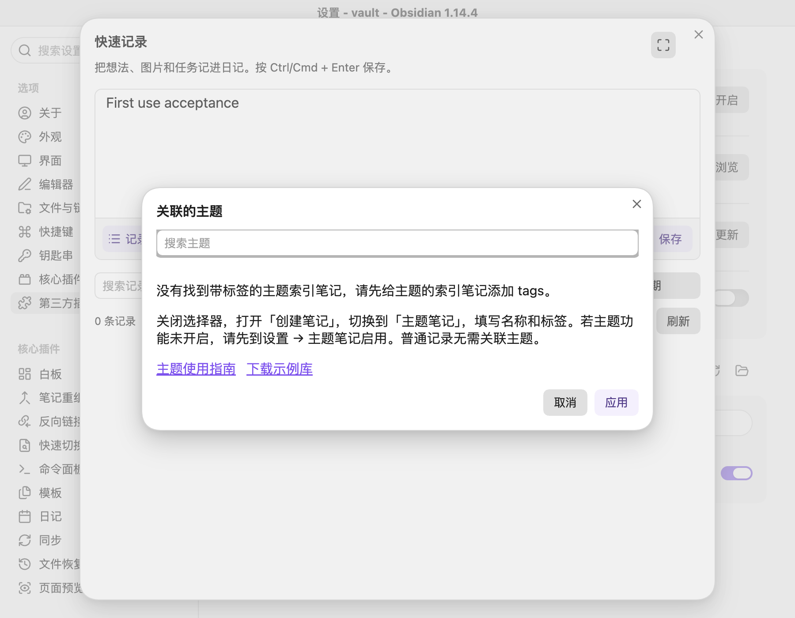

# 开始使用开源版 LifeOS

首次启用插件后，向导提供「直接开始记录」入口。它只补建缺失的基础日记模板，保留已有模板和笔记，不创建示例内容，也不固定 PARA 或主题模式。之后仍可运行初始化命令，选择适合自己的组织方式。

点击「快速记录」，输入内容，再点「保存」或按 Ctrl/Cmd + Enter。内容写入今日日记；普通记录无需关联主题。日记的保存与历史记录读取不需要 Dataview。

想按主题整理时，打开「创建笔记 → 主题笔记」，填写名称和标签；若主题功能关闭，先到插件设置中启用。索引笔记需要 `tags` 属性，主题选择器才会识别它。

选择器提供主题指南和示例库下载入口。关闭选择器不会清空草稿，可以继续保存普通记录。主题任务、记录和资料聚合查询需要安装并启用 Dataview。

与 Pro 并存时，在开源查询代码块中使用 `LifeOSOpen`；脚本使用 `LifeOSOpen.Theme.snapshot()` 等独立助手。现有笔记不会自动替换语法。

- [主题笔记指南](theme-notes.md)
- [配套示例库](https://github.com/quanru/obsidian-example-lifeos/tree/main/examples)
