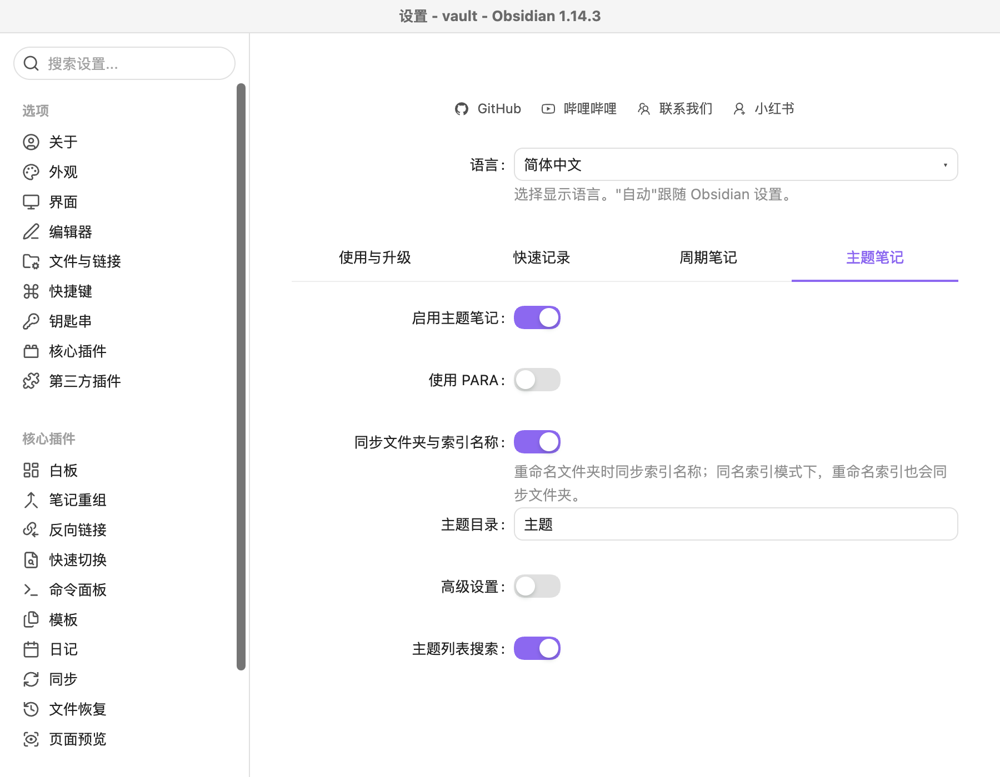
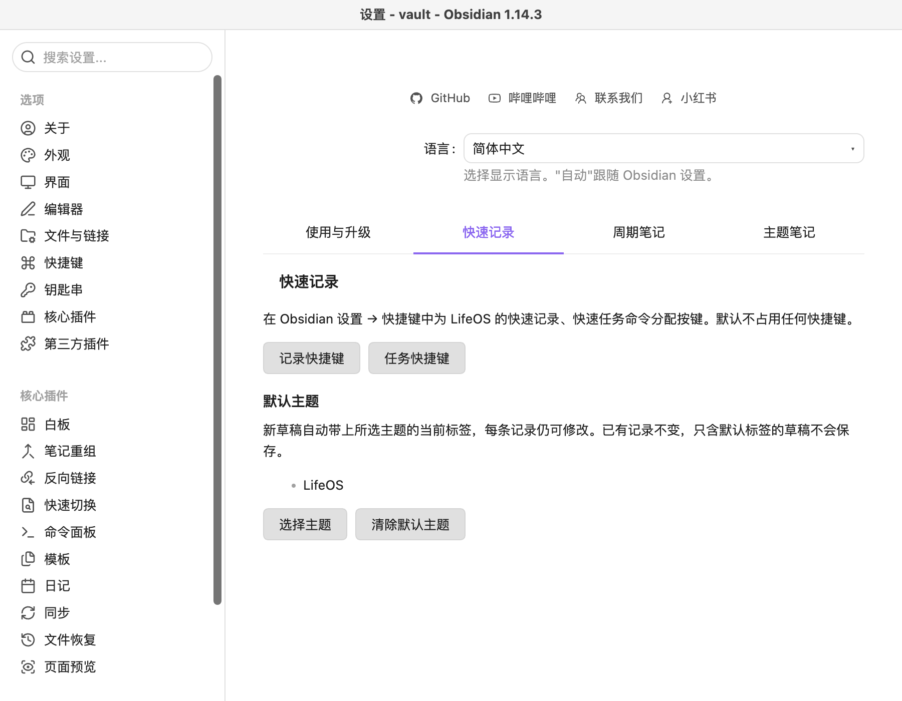
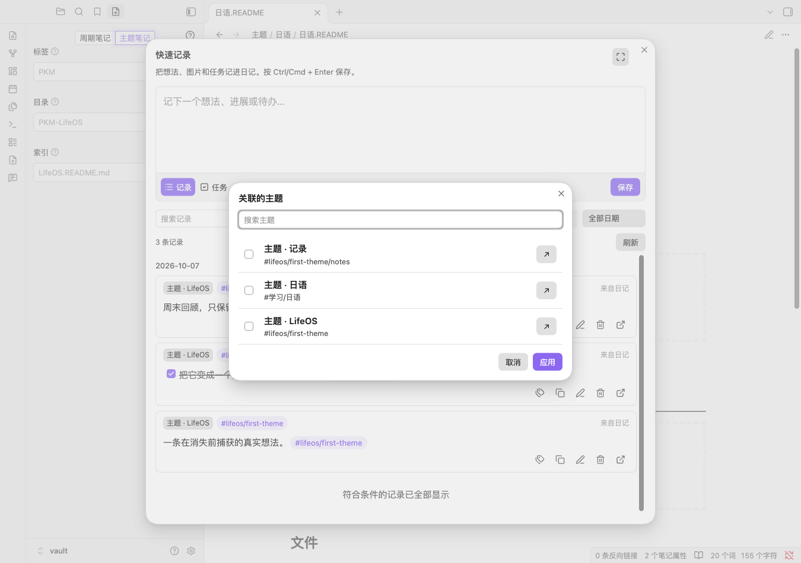
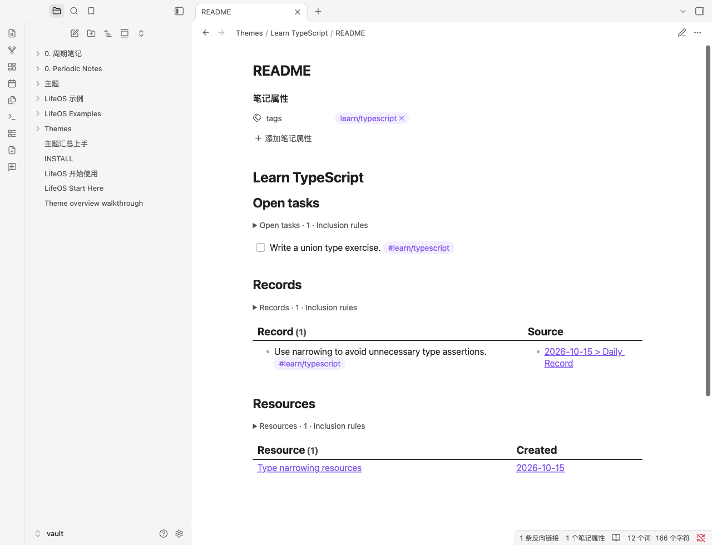
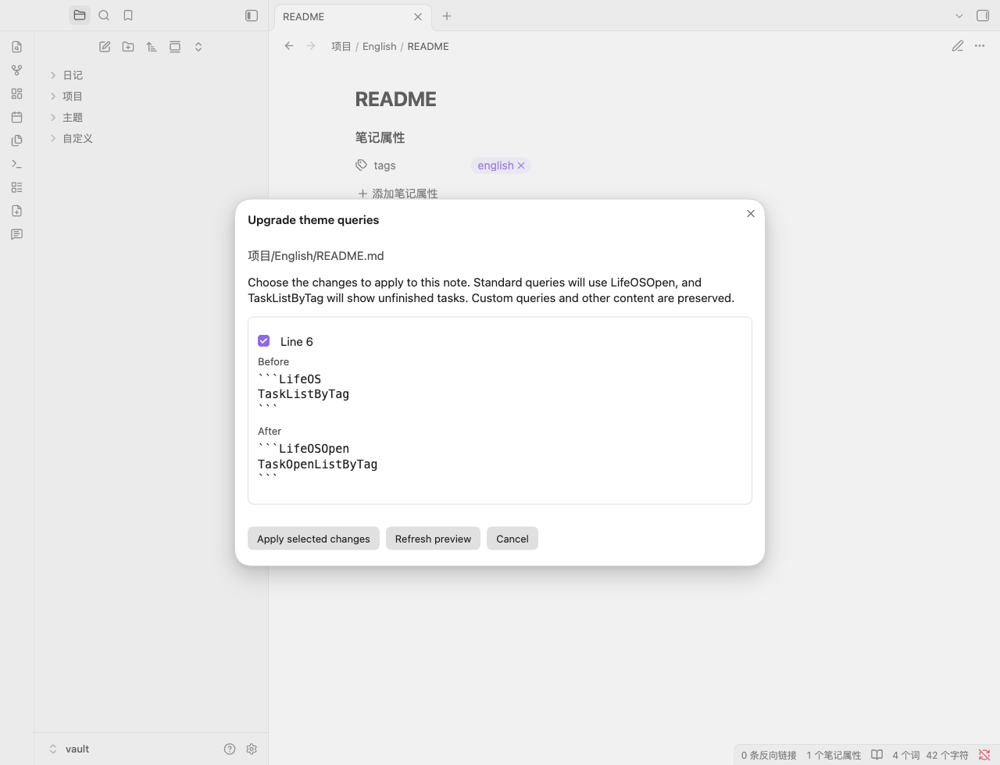

# Theme notes without PARA

Theme notes collect records, tasks and reference notes around a topic. Plain theme mode uses a configurable theme folder rather than requiring Projects, Areas, Resources and Archives. Existing PARA workflows remain available.

## Setup and creation

Choose **Theme notes** in workspace setup, or open Settings → Theme notes, enable theme notes and turn off **Use PARA**. Configure the theme folder. Changing modes keeps both sets of folder, naming and template settings; it does not move files or rewrite templates. Users who previously disabled PARA keep theme notes disabled after upgrading.

The screenshot shows the verified Simplified Chinese interface: the theme switch is enabled and the PARA switch is disabled. Advanced settings select README naming or a folder-name index and an optional custom template. Without advanced settings, the plugin uses README naming and Template.md in the theme root. A missing default template uses the built-in basic template; a missing explicitly configured custom template reports failure.

Open the LifeOS note creation panel and choose Theme notes. Enter a tag, folder and index, for example `#learning/japanese`, `Japanese`, and `Japanese.README.md`. README.md and prefixed \*.README.md are supported; folder-name mode uses Japanese/Japanese.md. Nested theme folders are supported. Ordinary notes, templates and untagged indexes are excluded from the association picker.

## Capture and query

Use **Associate themes** in quick capture, select a theme, enter text and save. Default themes also work in plain mode. Selecting a theme adds its first tag; a record matching any of its tags is associated. Existing multi-tag records are preserved. Shared tags can associate several themes; the picker warns about this and preserves tags needed by another selected theme.

Configure default themes in Settings → Quick capture → Choose themes. Plain theme mode supports this without PARA. Defaults store individual note paths, so themes sharing tags can be selected independently; records still match tags and may show multiple associated themes.

When a search has no matches, Clear search restores the list while keeping selections. Missing tags are reported only when there are no tagged theme indexes. Loading failures offer a retry and keep the draft. Keyboard selection keeps focus on the current checkbox.

The verified Chinese picker uses the same selection workflow. The built-in template includes TaskOpenListByTag, BulletListByTag, FileListByTag and ThemeListByTag blocks. ThemeListByFolder lists the configured theme directory. Lists support search and refresh after index changes. Checking a task writes back to the source note. Daily task and record queries use the same heading boundaries as quick capture, excluding habits and unrelated subsections. Template and theme-index notes are excluded from task and record results.

### Theme overview (1.29.2)

New built-in theme templates use `TaskOpenListByTag` for unfinished tasks, alongside records and resources. Checking a task updates its source note and removes it from the open list. Record source links and resource links open the original notes.

Each section displays its result count. Expand **Inclusion rules** to inspect matching tags and exclusions. Empty sections explain how to add content. Resources refresh after index changes too. Queries opened while Dataview is indexing recover automatically when the index is ready.

Task and record items match complete tags or descendant tags: `#learn/typescript` does not match `#learn/typescript-extra`. Resource results exclude periodic notes, templates, the current note and theme indexes.

Existing notes and custom templates are preserved. To show unfinished tasks in an existing overview, replace `TaskListByTag` with `TaskOpenListByTag` inside a `LifeOSOpen` code block. The old query continues to include completed tasks. The new query is available in open-source LifeOS 1.29.2 and newer. The screenshot shows English plugin content in a Chinese-language Obsidian host.

Quick capture, theme creation and native theme lists work without Dataview. Task, record and file query blocks still require Dataview. The screenshots use synthetic example content in an isolated Obsidian vault.

The quick capture composer shows the associated theme name beside the record/task switch. When multiple themes match, it shows the first name and an additional count; the tooltip and accessible label include all names. Manual tag edits update this summary, and saved-record editing uses the same behavior. Shared tags may match multiple themes.

## Upgrade existing theme notes and templates (1.29.2)

Open a theme index or a configured theme template, then run **LifeOS: Upgrade theme queries** from the command palette or choose **Upgrade theme queries** in the file menu. Plain themes and PARA indexes are supported. Updating the plugin does not rewrite existing notes automatically.

Review each change with its line number and before/after text. Select only the blocks you want to upgrade, then choose **Apply selected changes**. `TaskListByTag` becomes `TaskOpenListByTag`; compatible standard theme queries use `LifeOSOpen` so they can coexist with Pro.

Custom query parameters, other code blocks, handwritten text and headings are preserved. If the note changes after preview, applying stops and presents a fresh preview for confirmation. Already upgraded blocks are not duplicated. Leave a task block unselected if you want to retain its completed tasks.

## Dataview and empty results

Task, record and resource queries still require Dataview. Quick capture, theme creation and native theme lists do not. Installing LifeOS does not install Dataview automatically.

| State               | Next step                                                                        |
| ------------------- | -------------------------------------------------------------------------------- |
| Dataview missing    | Open community plugin settings, find Dataview, then install and enable it        |
| Dataview disabled   | Enable it in community plugin settings                                           |
| Indexing            | Results appear automatically when the index is ready; Retry is also available    |
| Missing theme tags  | Choose Edit theme tags and add valid tags to the note properties                 |
| No matching results | Expand Inclusion rules and check item tags, daily headings and completion status |

The Chinese and English plugin interfaces use the same workflow; screenshots were taken in a Chinese-language Obsidian host.

## Using other LifeOS plugins alongside the open-source plugin

When another plugin already owns the `LifeOS` or `PeriodicPARA` query language, the open-source plugin keeps those entries intact. Use `LifeOSOpen` as the code-block language to explicitly render an open-source query; query names remain the same. Templater may use `<% LifeOSOpen.Theme.snapshot() %>`. With only the open-source plugin installed, the existing `LifeOS` and `PeriodicPARA` entries remain compatible.

## Snapshots, renames and examples

The plain-theme daily template uses `{{snapshot:Theme}}`. LifeOS replaces it with the theme links present when the daily note is created. Older notes are not rewritten. Templater users may use `<% LifeOS.Theme.snapshot() %>`; existing PARA snapshot helpers remain available.

Optional name synchronization updates a matching folder-name index or Folder.README.md after a folder rename; README.md stays unchanged. In folder-name mode, renaming the index also renames its folder. Collisions are reported without overwriting the destination; the user's initial rename is retained.

Each language in the [open-source example repository](https://github.com/quanru/obsidian-example-lifeos) includes LifeOS Vault, LifeOS Blank Vault, LifeOS Theme Vault and LifeOS Theme Blank Vault. The theme example contains linked daily records, tasks, reference notes and a tagged habit entry to demonstrate filtering. Blank vaults contain only guides, templates and settings. Install the updated open-source LifeOS plugin and Dataview separately; no plugin binaries are bundled. The companion release is Examples 1.20.0; use LifeOS 1.29.0 or newer.

LifeOS Examples 1.21.0 adds **Learn TypeScript** and **Launch a personal site** to the Chinese and English populated `LifeOS Theme Vault` folders in the independent example repository. Open **Theme overview walkthrough** to test task writeback, record sources and resources. Blank vaults stay empty. These examples are included in the [1.21.0 download packages](https://github.com/quanru/obsidian-example-lifeos/releases/tag/1.21.0) and require open-source LifeOS 1.29.2 or newer.

[中文指南](theme-notes.md)
