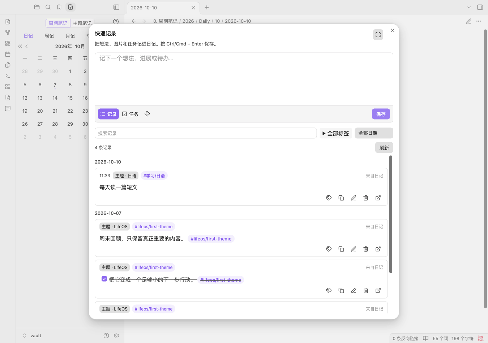
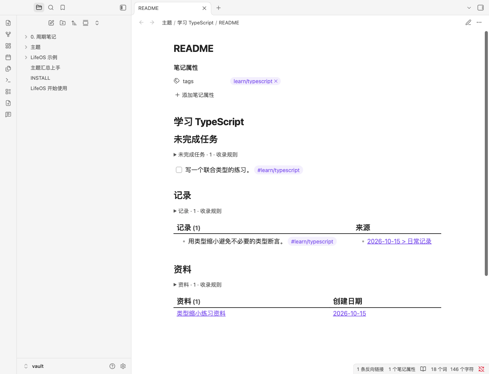
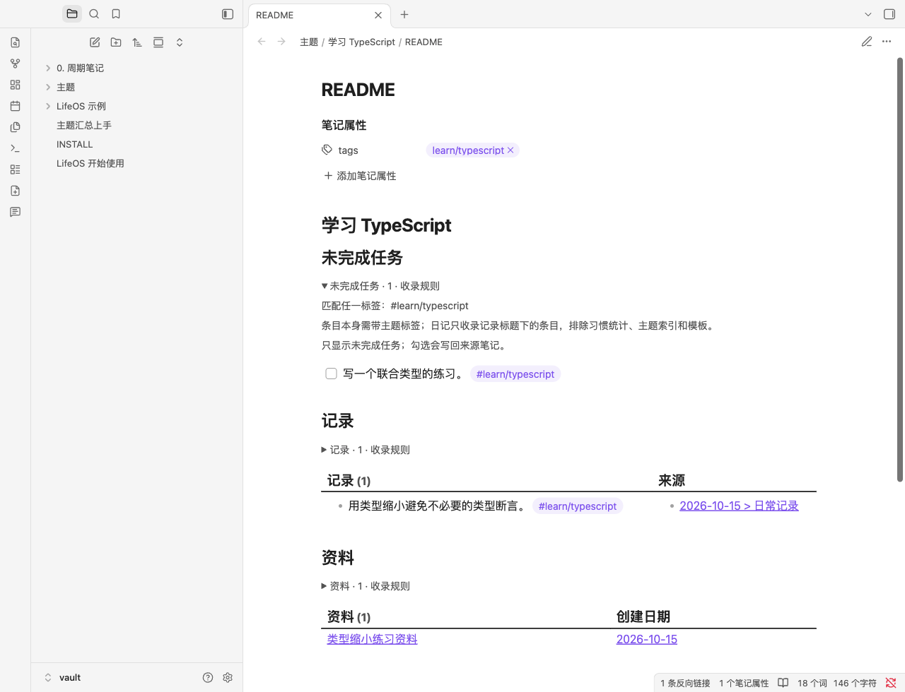
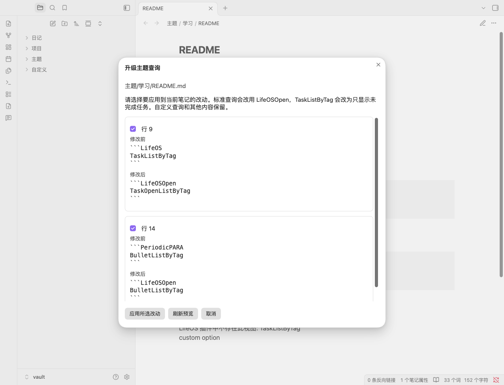
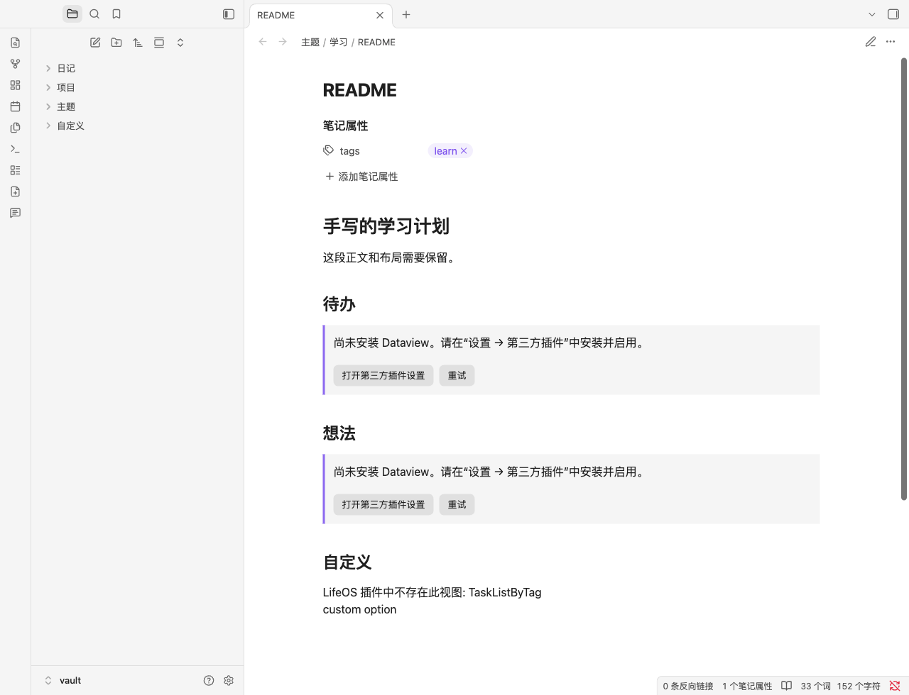

# 不绑定 PARA 的主题笔记

主题笔记把分散在日记和其他笔记中的记录、任务及资料集中到一个主题入口。普通主题模式无需创建项目、领域、资源和归档四类目录；原有 PARA 模式仍可使用。

## 开始使用

新库可以在初始化向导选择「主题笔记」。已有库进入插件设置 →「主题笔记」，启用主题笔记并关闭「使用 PARA」，再设置主题目录。切换模式不会搬动笔记或修改已有模板；普通主题和 PARA 的目录、索引命名、模板配置分别保留。


这里的「启用主题笔记」控制主题识别与创建，「使用 PARA」决定采用普通主题目录还是四类 PARA 目录。高级设置支持 README 风格、与文件夹同名的索引，以及自定义主题模板。未开启高级设置时使用 README 风格和主题目录中的 Template.md；默认模板缺失时，创建主题会使用内置基础模板。明确指定的自定义模板缺失时提示失败，不静默替换。

旧版中关闭了 PARA 的用户，升级后主题笔记也保持关闭；需要使用普通主题时再手动启用。

## 创建与关联

打开 LifeOS 创建笔记面板，切换到「主题笔记」，按顺序填写标签、目录和索引。例如：

```text
标签：#学习/日语
目录：日语
索引：日语.README.md
```

在「主题」目录下生成 `日语/日语.README.md`，并把标签写入笔记属性。README.md 与带前缀的 \*.README.md 均支持；同名模式使用 `日语/日语.md`。普通子笔记、模板文件和无标签索引不会进入快速记录的主题选择器。支持主题目录中的嵌套主题文件夹。

在快速记录输入框点击「关联主题」，搜索并选择主题，然后输入内容、保存到今日日记。默认主题设置也支持普通主题。选择主题会添加它的首个标签；记录包含该主题任一标签时，卡片就显示主题入口。已有记录无需重新保存或补齐全部标签。

输入时，记录/任务切换旁会显示当前关联的主题；多选时显示首个名称和额外数量，方便保存前确认。这个提示仍按实际标签匹配，共用标签的主题可能一起显示。

默认主题在插件设置 →「快速记录」→「选择主题」中设置，普通主题模式也可以使用。默认项按主题笔记分别保存，即使两篇主题共用标签，也可以只选其中一篇；记录卡片的关联仍按标签匹配，因此共用标签可能显示多个主题入口。


搜索没有命中时可点击「清除搜索」，已选主题会保留。只有主题目录中确实没有带标签的索引时，才提示添加标签；加载失败时可直接重试，草稿不会清空。使用键盘勾选主题后，焦点保留在当前选项，方便继续按 Tab 选择。




标签仍是普通 Markdown 标签。例如 `tags: [学习/日语, 日语]` 的主题，`#学习/日语` 或 `#日语` 都能识别关联。多个主题共用标签可能同时显示关联；选择器会提示，不能把共用标签当作主题的唯一身份。移除关联时保留其他已选主题需要的共用标签，也保留无关标签、笔记链接和代码示例。

## 查看记录、任务与文件

内置主题模板提供以下查询块：

| 查询              | 内容                                         |
| ----------------- | -------------------------------------------- |
| TaskOpenListByTag | 与主题标签关联的未完成任务，勾选写回来源笔记 |
| TaskListByTag     | 全部关联任务，保留原有查询行为               |
| BulletListByTag   | 与主题标签关联的记录，可打开来源             |
| FileListByTag     | 与主题标签关联的非周期资料笔记               |
| ThemeListByTag    | 与主题标签关联的其他主题索引                 |
| ThemeListByFolder | 配置主题目录中的主题列表                     |

```LifeOS
ThemeListByFolder
```

实际使用时，将上述代码块放入笔记并切换到阅读模式。主题列表支持搜索，查询会随索引变化刷新。主题自身和模板不会混入记录、任务结果；日记任务与记录采用快速记录的同一套标题边界规则，排除习惯统计及其他子标题中的条目。

### 主题汇总页（1.29.2）

新建主题的内置模板改用 `TaskOpenListByTag`，集中显示未完成任务、记录和资料。勾选任务后，原笔记会同步更新，任务也会从待办列表消失。记录的来源链接和资料链接都能打开原笔记。



每块内容上方显示条目数。展开「收录规则」可查看匹配标签和排除范围；没有内容时会提示如何添加记录、任务或资料。资料查询也会随索引变化刷新。启动时若 Dataview 仍在准备索引，索引完成后会自动恢复查询。

记录与任务按条目上的完整标签或其子标签匹配，例如 `#learn/typescript` 不会匹配 `#learn/typescript-extra`。资料按笔记标签查询；周期笔记、模板、当前页和主题索引不会出现在资料列表中。

已有笔记和自定义模板不会被覆盖。需要改为只看待办时，将任务块里的 `TaskListByTag` 改为 `TaskOpenListByTag`，代码块语言用 `LifeOSOpen`。继续使用原名称仍显示全部任务。此查询从开源版 1.29.2 起可用。



快速记录、主题创建和原生主题列表不依赖 Dataview。任务、记录和文件查询块仍需要安装、启用 Dataview；本次没有替换开源版既有查询依赖。

## 升级已有主题页与模板（1.29.2）

更新插件不会自动改写旧笔记。打开主题索引或已配置的主题模板，在命令面板执行「LifeOS: 升级主题查询」，也可以在文件菜单选择「升级主题查询」。普通主题和 PARA 索引都支持。

预览会列出每处改动的行号及修改前后内容。勾选需要升级的查询，再点击「应用所选改动」。`TaskListByTag` 会改为只显示未完成任务的 `TaskOpenListByTag`；兼容的标准主题查询会改用 `LifeOSOpen`，便于与 Pro 一起使用。



带自定义参数的查询、其他代码块、手写正文和标题不会改动。预览后笔记若被编辑，应用会停止并展示新的预览，需要再次确认。已完成升级的查询不会重复改写；想保留全部任务时，不勾选对应任务块。

## Dataview 与空结果排查

开源版的任务、记录和资料查询仍然需要 Dataview。快速记录、主题创建和原生主题列表不需要它。安装 LifeOS 不会自动安装 Dataview。

| 当前状态           | 如何处理                                               |
| ------------------ | ------------------------------------------------------ |
| 未安装 Dataview    | 点击「打开第三方插件设置」，搜索 Dataview 并安装、启用 |
| 已安装但未启用     | 在第三方插件设置中启用 Dataview                        |
| 正在准备索引       | 等待索引完成，查询会自动显示；必要时点击「重试」       |
| 主题没有有效标签   | 点击「编辑主题标签」，在笔记属性中补充 tags            |
| 查询正常但没有结果 | 展开「收录规则」，核对条目标签、日记标题和已完成状态   |



## 与其他 LifeOS 插件同时使用

如果其他插件已经使用 `LifeOS` 或 `PeriodicPARA` 查询语言，开源版不会抢占这些入口。需要明确使用开源版查询时，将代码块语言写成 `LifeOSOpen`，块内仍使用同样的查询名称。Templater 可以使用 `<% LifeOSOpen.Theme.snapshot() %>`。只安装开源版时，原有 `LifeOS` 和 `PeriodicPARA` 入口仍兼容。

## 日记快照与重命名

普通主题版的日记模板在主题标题下使用 `{{snapshot:Theme}}`。通过 LifeOS 创建日记时，它会替换成当时的主题索引链接列表；此后新增主题不会追溯改写旧日记。现有日记不会被覆盖。使用 Templater 的用户也可以继续调用 `<% LifeOS.Theme.snapshot() %>`；原有 `LifeOS.Project.snapshot()` 等 PARA 快照入口保留。

启用名称同步后：

- 重命名文件夹会同步与原文件夹同名的索引，包括 `原名称.md` 或 `原名称.README.md`；普通 README.md 保持原名。
- 同名索引模式下，重命名索引也会同步主题文件夹。
- 目标重名时提示冲突，不覆盖其他文件。用户已执行的第一次重命名保留，需要自行解决冲突；插件不会回滚用户操作。

## 配套示例库

[开源示例仓库](https://github.com/quanru/obsidian-example-lifeos) 的每种语言都提供四类工作库：原有 LifeOS Vault、LifeOS Blank Vault，以及新增 LifeOS Theme Vault、LifeOS Theme Blank Vault。

普通主题示例包含主题索引、关联资料、日记记录和任务，并放入同标签习惯任务用于验证过滤。空白版只保留指南、模板和配置。示例包不包含插件二进制，需单独安装更新后的开源版 LifeOS 和 Dataview。配套发行版为示例库 1.20.0，需搭配 LifeOS 1.29.0 或更新版本。

示例库 1.21.0 已在中英文 `LifeOS Theme Vault` 中提供配套内容：打开「主题汇总上手」或「Theme overview walkthrough」，依次体验「学习 TypeScript」和「发布个人网站」。每个案例都包含待办、已完成任务、记录、资料和来源日记；学习案例额外包含不应收录的习惯任务。空白库不添加演示数据。这些案例已包含在[示例库 1.21.0 下载包](https://github.com/quanru/obsidian-example-lifeos/releases/tag/1.21.0)中，需搭配开源插件 1.29.2 或更新版本。

[English guide](theme-notes.en.md)
