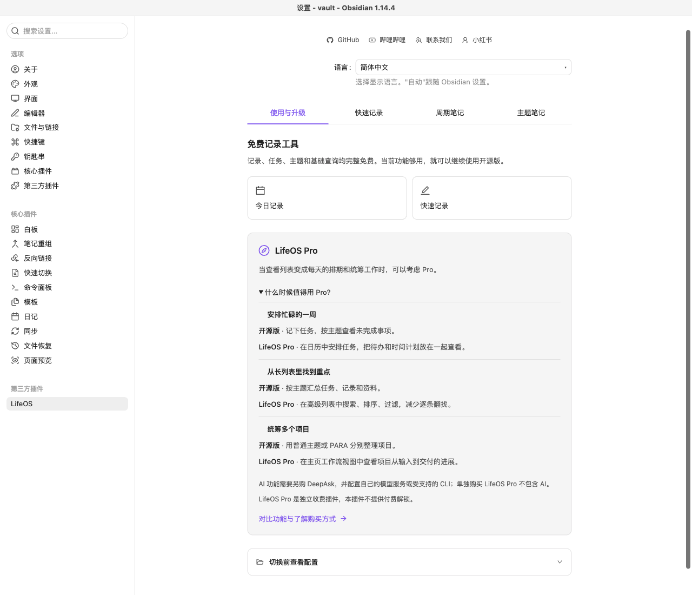
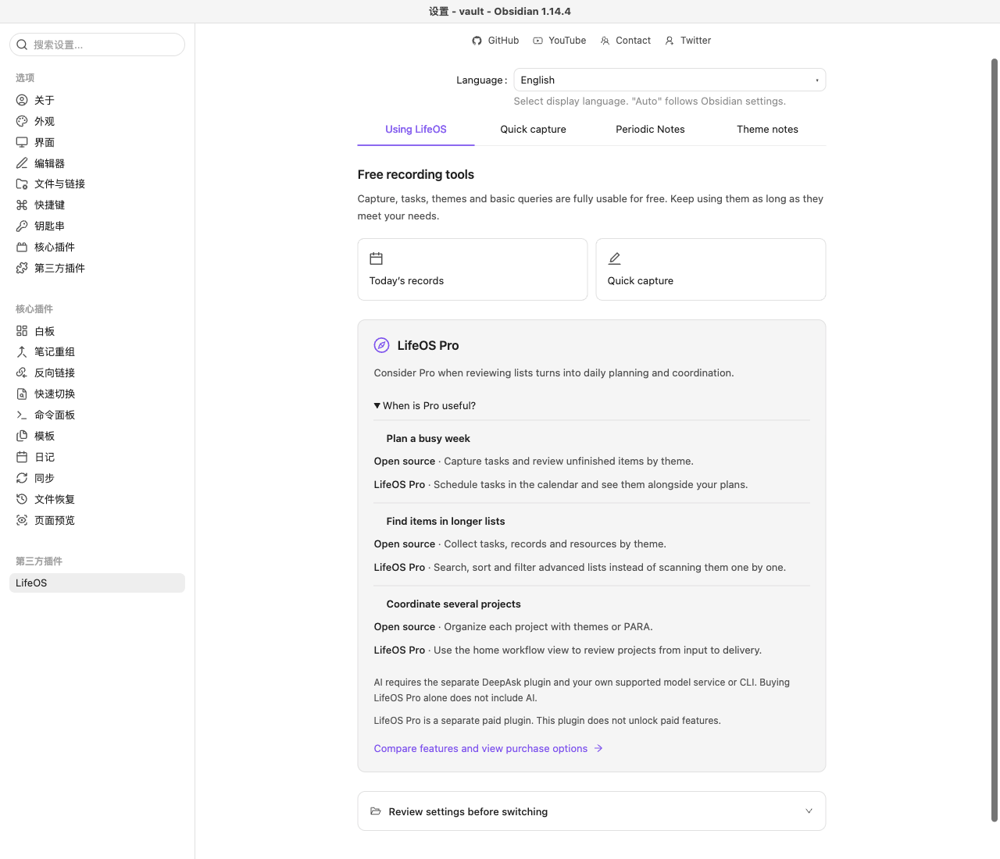

# 升级价值说明验收（2026-10-15）

在开源版 main 本地工作区完成，未提交、推送或发布。此前的 1.29.2 本地候选已被新源码取代，不能直接发布旧附件。

## 变更

「使用与升级」增加默认折叠的三组场景对照：一周排期、长列表检索、多项目统筹。保留单一购买链接与现有固定来源参数，明确开源能力完整免费、AI 需独立 DeepAsk。没有新增网络请求、遥测、限额或购买弹窗。

新文案提供简体中文、繁体中文和英文，其余语言暂回退英文。接管指南补齐中英文；运营文档明确哪些指标可用、哪些不可得，不宣称已接入订单归因。

能力描述依据本轮查看的 Pro 官方产品文档：日历、主页工作流、高级列表及价格页面的独立 AI 条件；没有将 Pro 源码或资源复制到开源版。

## 验证

- `pnpm build` 通过，现有 101 项测试全部通过。
- 真实 Obsidian 1.14.4，临时独立 profile / vault，mock keychain；只安装开源产物。
- 简中、繁中、英文：默认折叠、三组场景内容、单一固定来源购买链接、Enter 展开与收起通过。
- 600 CSS px 窄设置窗口内容无横向溢出；这是桌面窄窗口验证，不冒充手机实测。
- 已视觉检查中英文截图；宿主 Obsidian 使用中文，英文截图中的插件内容为英文。
- 验证结束关闭本次实例并清理临时 profile、vault 和产物副本；用户主库未修改。

本轮只验证链接属性，没有打开官网下单或验证线上归因；不改官网、不部署统计服务。产物 SHA-256 和运行断言见同名 JSON。原始截图位于 `/Volumes/T5/personal/studio_4/.verify/oss-value-20261015/`。
